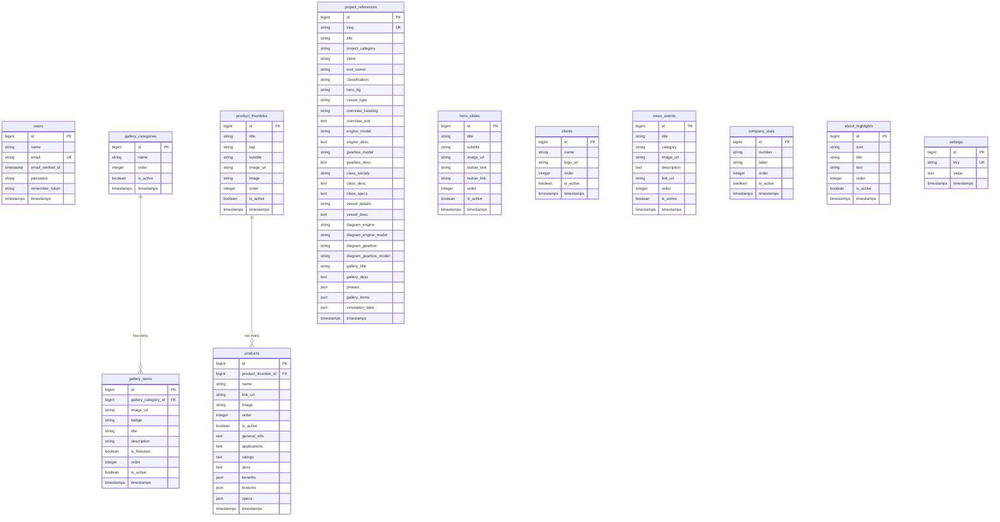

# ACI Marine Database Schema Documentation

This document describes the structure of the database tables, Eloquent models, cast types, and relationships in the **ACI Marine** Laravel application.

---

## 1. Entity-Relationship Diagram (ERD)

---

## 2. Table Schemas & Eloquent Models

### 2.1 Gallery Category Layer

#### `gallery_categories`
Stores custom categories managed by the administrator for grouping images in the website gallery.
* **Eloquent Model**: `App\Models\GalleryCategory`
* **Schema Fields**:
  * `id` (`BIGINT`, PK, Auto-increment)
  * `name` (`VARCHAR(255)`, Category Label)
  * `order` (`INT`, Sorting sequence order)
  * `is_active` (`TINYINT(1)`, Default `1`)
  * `created_at` / `updated_at` (`TIMESTAMP`)
* **Relationships**:
  * `galleryItems()` -> `HasMany` (`App\Models\GalleryItem`)

#### `gallery_items`
Holds the individual photos, titles, and descriptions that belong inside the Gallery grid.
* **Eloquent Model**: `App\Models\GalleryItem`
* **Schema Fields**:
  * `id` (`BIGINT`, PK, Auto-increment)
  * `gallery_category_id` (`BIGINT`, FK pointing to `gallery_categories.id`, nullable, on delete cascade)
  * `image_url` (`VARCHAR(255)`, URL or path to media asset)
  * `badge` (`VARCHAR(255)`, Optional small overlay badge)
  * `title` (`VARCHAR(255)`)
  * `description` (`TEXT`)
  * `is_featured` (`TINYINT(1)`, Default `0`)
  * `order` (`INT`, Sorting sequence order)
  * `is_active` (`TINYINT(1)`, Default `1`)
  * `created_at` / `updated_at` (`TIMESTAMP`)
* **Relationships**:
  * `galleryCategory()` -> `BelongsTo` (`App\Models\GalleryCategory`)

---

### 2.2 Product Division Layer

#### `product_thumbles`
Defines the business areas or category divisions for machinery (e.g. propulsion engines, steering gears).
* **Eloquent Model**: `App\Models\ProductThumble`
* **Schema Fields**:
  * `id` (`BIGINT`, PK, Auto-increment)
  * `title` (`VARCHAR(255)`)
  * `tag` (`VARCHAR(255)`, Code tag)
  * `subtitle` (`VARCHAR(255)`)
  * `image_url` (`VARCHAR(255)`, Fallback image path)
  * `image` (`VARCHAR(255)`, Custom upload path, overrides `image_url`)
  * `order` (`INT`, Sort order)
  * `is_active` (`TINYINT(1)`, Default `1`)
  * `created_at` / `updated_at` (`TIMESTAMP`)
* **Relationships**:
  * `products()` -> `HasMany` (`App\Models\Product`)

#### `products`
The individual physical models/items sold or serviced under each division. Includes details for tabs on product sheets.
* **Eloquent Model**: `App\Models\Product`
* **Schema Fields**:
  * `id` (`BIGINT`, PK, Auto-increment)
  * `product_thumble_id` (`BIGINT`, FK pointing to `product_thumbles.id`, on delete cascade)
  * `name` (`VARCHAR(255)`)
  * `link_url` (`VARCHAR(255)`, Relative URL route)
  * `image` (`VARCHAR(255)`, Uploaded file path)
  * `order` (`INT`)
  * `is_active` (`TINYINT(1)`, Default `1`)
  * `general_info` (`TEXT`, HTML specifications layout)
  * `applications` (`TEXT`, HTML specifications layout)
  * `ratings` (`TEXT`, HTML specifications layout)
  * `docs` (`TEXT`, Links or references)
  * `benefits` (`JSON`, Casted to `array`)
  * `features` (`JSON`, Casted to `array`)
  * `specs` (`JSON`, Casted to `array`)
  * `created_at` / `updated_at` (`TIMESTAMP`)
* **Relationships**:
  * `productThumble()` -> `BelongsTo` (`App\Models\ProductThumble`)

---

### 2.3 Project Reference Layer

#### `project_references`
Complex project entries detailing the ship/vessel builds, machinery configured, custom timelines, and interactive HTML5 simulation metrics.
* **Eloquent Model**: `App\Models\ProjectReference`
* **Schema Fields**:
  * `id` (`BIGINT`, PK, Auto-increment)
  * `slug` (`VARCHAR(255)`, Unique slug for routes)
  * `title` (`VARCHAR(255)`)
  * `project_category` (`VARCHAR(255)`, Engine & Gearbox, Propulsion, etc.)
  * `client` (`VARCHAR(255)`)
  * `end_owner` (`VARCHAR(255)`)
  * `classification` (`VARCHAR(255)`)
  * `hero_bg` (`VARCHAR(255)`)
  * `vessel_type` (`VARCHAR(255)`)
  * `overview_heading` (`VARCHAR(255)`)
  * `overview_text` (`TEXT`)
  * `engine_model` (`VARCHAR(255)`)
  * `engine_desc` (`TEXT`)
  * `gearbox_model` (`VARCHAR(255)`)
  * `gearbox_desc` (`TEXT`)
  * `class_society` (`VARCHAR(255)`)
  * `class_desc` (`TEXT`)
  * `class_specs` (`TEXT`)
  * `vessel_details` (`VARCHAR(255)`)
  * `vessel_desc` (`TEXT`)
  * `diagram_engine` (`VARCHAR(255)`, e.g., Brand logo name)
  * `diagram_engine_model` (`VARCHAR(255)`)
  * `diagram_gearbox` (`VARCHAR(255)`)
  * `diagram_gearbox_model` (`VARCHAR(255)`)
  * `gallery_title` (`VARCHAR(255)`)
  * `gallery_desc` (`TEXT`)
  * `phases` (`JSON`, Timeline milestone logs. Casted to `array`)
  * `gallery_items` (`JSON`, Slider gallery image list. Casted to `array`)
  * `simulation_data` (`JSON`, Dynamic dashboard bounds. Casted to `array`)
  * `created_at` / `updated_at` (`TIMESTAMP`)

---

### 2.4 Website Components and Configurations

#### `hero_slides`
* **Eloquent Model**: `App\Models\HeroSlide`
* **Schema Fields**: `id`, `title`, `subtitle`, `image_url`, `button_text`, `button_link`, `order`, `is_active`, `timestamps`.

#### `clients`
* **Eloquent Model**: `App\Models\Client`
* **Schema Fields**: `id`, `name`, `logo_url`, `order`, `is_active`, `timestamps`.

#### `news_events`
* **Eloquent Model**: `App\Models\NewsEvent`
* **Schema Fields**: `id`, `title`, `category`, `image_url`, `description`, `link_url`, `order`, `is_active`, `timestamps`.

#### `company_stats`
* **Eloquent Model**: `App\Models\CompanyStat`
* **Schema Fields**: `id`, `number` (e.g. "200+"), `label` (e.g. "Vessels Completed"), `order`, `is_active`, `timestamps`.

#### `about_highlights`
* **Eloquent Model**: `App\Models\AboutHighlight`
* **Schema Fields**: `id`, `icon` (SVG markup or name), `title`, `text`, `order`, `is_active`, `timestamps`.

#### `settings`
* **Eloquent Model**: `App\Models\Setting`
* **Schema Fields**: `id`, `key` (Unique key index), `value` (`TEXT` or HTML content), `timestamps`.
